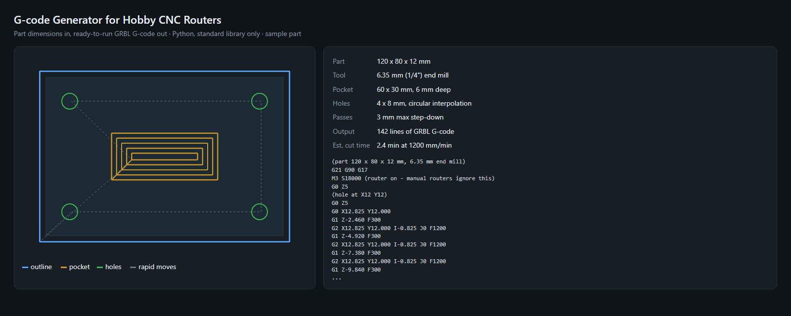

# G-code Generator for Hobby CNC Routers

Turns simple part dimensions into ready-to-run GRBL G-code for a hobby CNC router (Bob's CNC, Shapeoko and similar).
Python, standard library only.



## What it cuts

- Corner holes by circular interpolation (`G2`), stepping down in passes
- A rectangular pocket, cleared center-out
- The part outline, with a thin onion skin left so the part can't break free on the last pass

## Run it

```
python gcode_gen.py
```

It writes `part.nc` (the G-code), `preview.svg` (the toolpath) and `showcase.html` next to the script.
Change the part, tool, feeds and depths in the `Job` dataclass at the top of the file. Units are mm; the
origin is the front-left corner of the stock, and Z0 is the top of the stock.

The script checks itself before writing anything: pass depths, that no move goes below the stock or
outside the part plus the tool radius, and that the program starts with `G21 G90 G17` and ends with `M30`.

## Before you cut

Simulate `part.nc` (CAMotics works well), then do an air cut above the stock before cutting real material.
